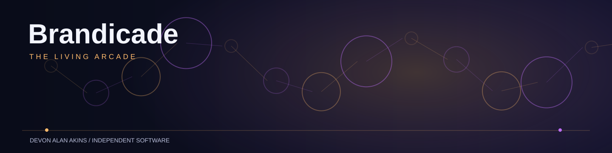

<p align="center"></p>

# Brandicade — The Living Arcade

Brandicade is a private, offline-first family arcade built for Brandi, with Kahlua as its **only companion character**. Its game engines, public-safe source, and verification tests live here. Private game progress belongs to its original browser origin and protected storage, not to this public repository.

## Source versus production (November 6, 2026)

| System | Verified state |
| --- | --- |
| **Production** — [brandicade.anevum.com](https://brandicade.anevum.com) | Existing protected Worker `9b88b22c-d740-4e8f-b35a-5178a627a8e2` still serves **100% of live traffic**. Corrected v11 candidate `b98da834-ce76-4c45-8f19-95f802f6e904` is uploaded and independently hash-verified but **INACTIVE**. Older v9/v10 inactive candidates are superseded. |
| **Latest source** | Source commit `1e8c4cf85269438ca291a770b814ac186710577a` adds strict lossless export and fail-closed Glimmer writes, preserving exact raw recovery files; [full post-merge CI](https://github.com/devonalanakins/brandicade/actions/runs/42330373171) passed in Chromium/WebKit, including isolated synthetic restore. This is not original-iPhone acceptance. |
| **Production upgrade method** | The inactive v11 Worker copies the source-exact **private staging static assets**, including the deliberate new Glimmer save guard, into the **existing production** signed Access/API/D1 runtime. Six other save-critical modules remain byte-identical. Reconstructed backend PR #12 is **not** used. |
| **Staging** — [prism.anevum.com](https://prism.anevum.com) | **v11 LIVE privately** on Worker `brandicade-prism-preview-20261103` version `b7fb7f2c-0d0c-4295-b6c7-a5338d4f77a3`, deployment `cd38cc2b-e6c9-4d71-9006-9e2a3152a7b0`, 100% staging traffic. Access and D1 remain isolated; original-device saves are origin-specific. |
| **Repository integration** | Arcade [PR #16](https://github.com/devonalanakins/brandicade/pull/16), backup checks [PR #21](https://github.com/devonalanakins/brandicade/pull/21), lossless restore [PR #26](https://github.com/devonalanakins/brandicade/pull/26), and **lossless export/write protection [PR #28](https://github.com/devonalanakins/brandicade/pull/28)** are merged. **No production traffic change occurred.** |

**Do not deploy or upload `dist/brandicade.worker.js`, or any unbundled candidate, over the protected production Worker.** The standalone static artifact lacks production Access and cloud-save APIs. No existing origin, D1 record, Cloudflare Access application, or Safari storage may be reset to simplify a release.

## What the latest release candidate includes

- **Living Arcade:** Kahlua-only welcome and responsive forest-green atrium; no Brandi avatar or fabricated achievements.
- **Glimmer Pop:** original 7×7 match game with progression, awards, save protection, animation and pause isolation.
- **Prism Garden:** 18 original deterministic jewel puzzles across three worlds, accessible guided hints, undo, living-scene restoration, own local backup and earned achievements.
- **Unified controls:** touch and keyboard, plus synthetic-tested Xbox standard Gamepad API mapping, pause/back/selection, directional navigation, and landscape CSS for short phone viewports. Actual physical iPhone/Bluetooth Xbox acceptance remains open.
- **Shared arcade passport:** rewards derived only from legitimately earned game progress; no synthetic awarded status.
- **Brandle:** direct launch to its existing independently hosted origin; no iframe or automatic migration of its saved progress.
- **Private storage:** explicit device backup/export/import; opt-in Glimmer Pop cloud reconciliation. Prism Garden uses its own separate local namespace. Cloud save write recovery is a candidate and must not be assumed live.

The existing source contains focused Node tests, Python build and recovery tests, WebKit/Chromium browser tests, and nondeploying protected Worker simulation and Wrangler dry-run bundling. At current source head `1e8c4cf85269438ca291a770b814ac186710577a`, [full CI run 42330373171](https://github.com/devonalanakins/brandicade/actions/runs/42330373171) succeeded, including exact static provenance, protected Worker dry-run and Chromium/WebKit browser tests. Its browser/device simulations do **not** establish physical-device, authenticated production, backup/restore, or licensing acceptance.

## Local development and verification

```sh
python3 -m http.server 8788
node --test tests/logic.test.mjs
python3 -m unittest discover -s tests -p 'test_*.py' -v
python3 build_worker.py
python3 scripts/verify_release_assets.py --output dist/brandicade-release-assets.json
python3 scripts/build_brandicade_protected.py
```

The static source browser is for **local gameplay preview only**; it cannot exercise real protected cloud writes. `verify_release_assets.py` compares each deterministic static Worker route, MIME type and decompressed bytes to the current repository and writes a content-addressed **frontend-only** receipt; it neither asserts server parity nor deploys. The protected builder generates an **unbundled review candidate**; the GitHub verification workflow uses a pinned Wrangler dry-run bundle and synthetic security tests. Build outputs remain under `dist/`.

## Release and privacy boundaries

**Release remains gated** until the owner completes or documents evidence for:

1. Signed-in real-player and admin access checks on private staging, including denied users.
2. Safe owner-held backup of any real device/cloud saves, isolated verified restore, and origin-preserving reload/upgrade checks.
3. Production-equivalent Access/D1 bindings, legacy save API contract, conflict/rollback tests, and reviewed secrets/configuration (never committed).
4. Real iPhone Safari/PWA/offline/touch accessibility and physical Bluetooth Xbox testing.
5. MIT/GPLv3 source and generated Worker header provenance reconciliation, preserving all applicable notices.
6. Reviewed production release artifact, current deployment/rollback identifiers, observed post-deployment checks, and only then retirement of the obsolete Prism hostname.

For current evidence, see the [v11 pinned release gate](docs/PRODUCTION_V11_RELEASE_GATE_2026-11-06.md), [device acceptance instructions](docs/DEVICE_BACKUP_ACCEPTANCE_2026-11-06.md), and [cutover checklist](docs/BRANDICADE_MAIN_CUTOVER_2026-11-06.md). The production release checks and sign-off are tracked in [release issue #24](https://github.com/devonalanakins/brandicade/issues/24) and the [living project record](https://app.notion.com/p/40a88cc2ef1481bbbcdce71be63b935e). [Issue #2](https://github.com/devonalanakins/brandicade/issues/2) tracks the separate Brandle integration, not the production cutover.

This remains an independent **family project**, not part of ANEVUM's commercial creative universe. Never add access tokens, partner information, private photos, personal save blobs, or clinical records to public source. The existing MIT `LICENSE` and inherited GPLv3 Worker header present an unresolved **license discrepancy**; see the [source-rights provenance audit](docs/SOURCE_RIGHTS_PROVENANCE_2026-11-06.md). It traces both statements to the October 30 recovery commit, but does not establish upstream rights. Do not silently remove, replace, or reinterpret either without owner review.
